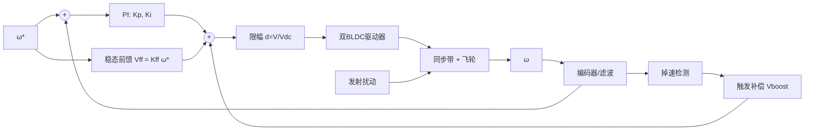

# 飞轮系统控制理论研究报告

> **版本与实测修正说明（2026-10-27 补注）**
> 本报告的**物理建模部分（第 2~4 章：电气/机械方程、二阶传递函数、一阶约分）未作任何改动**，它在本项目上仍然成立。
> 但本报告写作时（第 3 代）的**控制律与实现细节已被第 4 代取代**（2026-10-22，`0969cbd` 删除 boost），
> 且实机数据暴露出若干与理论式不符的量级偏差。因此在不动物理建模的前提下，做了两类小修正：
> ① 在第 5~7 章的相关式子旁加「**实测修正**」注记（保留原式，另注实际值/实际形式）；
> ② 文末新增 **第 10 章「第 4 代实现差异与实测修正汇总」**，集中列出五个偏差与现行参数。
> 现行控制律、参数与验收判据以 `doc/现在的控制系统.md` 为准。

## 摘要

本报告针对“两个无刷直流电机经同步带共同驱动同一轴、轴上装有惯性飞轮”的系统，研究其速度控制模型与控制方案。控制量为电机端电压 $V$（V），代码实现中通过“电压 → 占空比”两步输出；被控量为飞轮角速度 $\omega$（rad/s）。应用场景为飞轮高速旋转后发射接触小球，发射瞬间飞轮会因冲击而明显掉速，且系统无法控制发射瞬间，但可检测到明显掉速。

报告建立双电机—同步带—飞轮的等效单轴模型，给出精确二阶传递函数，并通过忽略电气快动态得到一阶简化模型。最终控制方案为：**一阶等效模型 + 稳态前馈 + PI 反馈 + 掉速检测触发补偿**。标定部分采用**无电气参数、无机械参数**的黑箱辨识方法，包括阶跃响应法、Ziegler-Nichols 临界比例度法和继电反馈自整定法。报告还给出完整参数表、控制参数含义、控制框图及改进方案。

---

## 1. 研究背景与系统描述

飞轮系统结构：

- 2 个无刷直流电机（BLDC）；
- 两个电机通过同步带轮连接，共同驱动同一轴；
- 轴上安装一个重量略重的惯性飞轮；
- 控制量为电机端电压 $V$（V），实际代码中转换为 PWM 占空比 $d$；
- 被控制量为飞轮角速度 $\omega$（rad/s）；
- 应用场景：飞轮高速旋转，发射与其接触的小球；
- 发射瞬间飞轮受到冲击，产生明显掉速；
- 系统无法控制发射瞬间，但可以检测到明显掉速。

控制目标：

1. 飞轮能够稳定运行在设定转速 $\omega^*$；
2. 发射小球后，在检测到掉速的情况下，尽快恢复到设定转速；
3. 控制算法简单、易实现，允许一定误差；
4. 标定过程不依赖电气参数和机械参数测量。

---

## 2. 简化假设

为得到工程可用的控制模型，作如下简化假设：

1. 两个 BLDC 参数完全相同，采用相同端电压或相同占空比驱动；
2. 同步带刚性足够，忽略打滑与柔性；
3. 忽略电机齿槽转矩、死区、母线电压波动等非线性因素；
4. 忽略电气快动态时，电感 $L$ 的影响可约分掉；
5. 粘滞阻尼 $B_{eq}$ 较小，必要时可进一步忽略；
6. 发射扰动为短时脉冲，无法预知，只能通过掉速检测后补偿；
7. 标定控制参数时，将整个系统视为黑箱，仅利用占空比输入和速度输出。

---

## 3. 符号表与参数定义

| 符号 | 含义 | 单位 | 备注 |
|------|------|------|------|
| $V$ | 电机端电压 | V | 控制量 |
| $V_{dc}$ | 直流母线电压 | V | 测量或已知 |
| $d$ | PWM 占空比 | 无量纲，0~1 | 实际输出 |
| $i_1, i_2$ | 两个电机电枢电流 | A | 内部变量 |
| $I$ | 总电流 $I=i_1+i_2$ | A | 内部变量 |
| $R$ | 单电机电枢电阻 | $\Omega$ | 不测量 |
| $L$ | 单电机电枢电感 | H | 不测量 |
| $K_e$ | 反电动势系数 | V·s/rad | 不测量 |
| $K_t$ | 转矩系数 | N·m/A | 不测量 |
| $n$ | 传动比 $n=\omega_m/\omega_f$ | 无量纲 | 可测齿数或转速比 |
| $\omega_m$ | 电机角速度 | rad/s | 内部变量 |
| $\omega_f=\omega$ | 飞轮角速度 | rad/s | 被控量 |
| $J_f$ | 飞轮转动惯量 | kg·m² | 不测量 |
| $J_m$ | 单个电机转子及带轮折算前转动惯量 | kg·m² | 不测量 |
| $J_{eq}$ | 折算到飞轮轴总惯量 $J_f+2n^2J_m$ | kg·m² | 不测量 |
| $B_{eq}$ | 折算到飞轮轴总粘滞阻尼 | N·m·s/rad | 不测量 |
| $T_L$ | 外部扰动转矩折算到飞轮轴 | N·m | 不测量 |
| $T_{shot}$ | 发射小球扰动转矩 | N·m | 不测量 |
| $m$ | 小球质量 | kg | 可测 |
| $v$ | 小球出射速度 | m/s | 可测 |
| $r$ | 飞轮与小球接触半径 | m | 可测 |
| $\Delta\omega$ | 掉速量 | rad/s | 可估计 |
| $\tau_e$ | 电气时间常数 $L/R$ | s | 不测量 |
| $\tau_m$ | 机械时间常数 | s | 不测量 |
| $K_0$ | 电压到速度稳态增益 | rad/(s·V) | 不测量 |
| $K_d$ | 占空比到速度稳态增益 | rad/(s·占空比) | 黑箱辨识 |
| $\tau$ | 一阶模型时间常数 | s | 黑箱辨识 |
| $s$ | 拉普拉斯变量 | 1/s | — |
| $K_p$ | PI 比例增益 | 占空比/(rad/s) | 标定 |
| $K_i$ | PI 积分增益 | 占空比/(rad/s·s) | 标定 |
| $\tau_c$ | 期望闭环时间常数 | s | 设计 |
| $\omega_c$ | 开环截止频率 | rad/s | 设计 |
| $\omega_{bw}$ | 闭环带宽 | rad/s | 设计 |
| $T_s$ | 采样周期 | s | 代码设定 |
| $\tau_f$ | 滤波时间常数 | s | 设计 |
| $\Delta\omega_{th}$ | 掉速检测阈值 | rad/s | 标定 |
| $k_{th}$ | 掉速速率阈值 | rad/s² | 标定 |
| $K_{boost}$ | 掉速补偿增益 | 占空比/(rad/s) | 标定 |
| $V_{boost}$ | 掉速补偿电压 | V | 内部变量 |
| $V_{ff}$ | 前馈电压 | V | 内部变量 |
| $V_{fb}$ | 反馈电压 | V | 内部变量 |
| $T_{boost}$ | 补偿持续时间 | s | 标定 |
| $PM$ | 相位裕度 | ° | 设计 |
| $K_u$ | 临界增益 | 占空比/(rad/s) | 实验 |
| $T_u$ | 临界振荡周期 | s | 实验 |
| $K_{ff}$ | 前馈增益 | V/(rad/s) | 标定 |
| $d_{ss}$ | 目标速度稳态占空比 | 无量纲 | 实验 |
| $\sigma_\omega$ | 稳态速度标准差 | rad/s | 实验 |
| $k_\sigma$ | 阈值倍数 | 无量纲 | 通常 3~5 |
| $k_{rate}$ | 减速度倍数 | 无量纲 | 通常 2~3 |

---

## 4. 数学模型与传递函数

### 4.1 电气方程

两个电机同电压驱动，总电流 $I=i_1+i_2$。单个电机电气方程为

$$
L\frac{di}{dt}+Ri=V-K_e\omega_m
$$

其中 $\omega_m=n\omega$，所以

$$
L\frac{dI}{dt}+RI=2V-2K_en\omega
$$

### 4.2 机械方程

两个电机总电磁转矩为 $T_m=K_tI$，折算到飞轮轴：

$$
T_d=nK_tI
$$

机械方程：

$$
J_{eq}\frac{d\omega}{dt}=nK_tI-B_{eq}\omega-T_L
$$

其中

$$
J_{eq}=J_f+2n^2J_m
$$

### 4.3 精确传递函数

消去电流 $I$，得到电压到飞轮角速度的传递函数：

$$
\boxed{
\frac{\Omega(s)}{V(s)}
=
\frac{2nK_t}
{J_{eq}Ls^2+(J_{eq}R+B_{eq}L)s+(B_{eq}R+2n^2K_tK_e)}
}
$$

若控制量为占空比 $d$，且 $V=V_{dc}d$，则

$$
\boxed{
\frac{\Omega(s)}{D(s)}
=
V_{dc}\frac{2nK_t}
{J_{eq}Ls^2+(J_{eq}R+B_{eq}L)s+(B_{eq}R+2n^2K_tK_e)}
}
$$

扰动 $T_L$ 到速度的传递函数：

$$
\boxed{
\frac{\Omega(s)}{T_L(s)}
=
-\frac{Ls+R}
{J_{eq}Ls^2+(J_{eq}R+B_{eq}L)s+(B_{eq}R+2n^2K_tK_e)}
}
$$

### 4.4 约分简化：一阶模型

电气时间常数：

$$
\tau_e=\frac{L}{R}
$$

机械时间常数：

$$
\tau_m=
\frac{J_{eq}R}{B_{eq}R+2n^2K_tK_e}
$$

当

$$
\tau_e\ll\tau_m
$$

即电气动态远快于机械动态时，可忽略电感 $L$，得到一阶模型：

$$
\boxed{
\frac{\Omega(s)}{V(s)}
\approx
\frac{K_0}{\tau s+1}
}
$$

其中

$$
\boxed{
K_0=
\frac{2nK_t}{B_{eq}R+2n^2K_tK_e}
}
$$

$$
\boxed{
\tau=
\frac{J_{eq}R}{B_{eq}R+2n^2K_tK_e}
}
$$

占空比形式：

$$
\boxed{
\frac{\Omega(s)}{D(s)}
\approx
\frac{K_d}{\tau s+1}
}
$$

其中

$$
\boxed{
K_d=V_{dc}K_0=
V_{dc}\frac{2nK_t}{B_{eq}R+2n^2K_tK_e}
}
$$

若进一步忽略粘滞阻尼 $B_{eq}$，则

$$
\boxed{
K_0\approx \frac{1}{nK_e}
}
$$

$$
\boxed{
\tau\approx \frac{J_{eq}R}{2n^2K_tK_e}
}
$$

$$
\boxed{
K_d\approx \frac{V_{dc}}{nK_e}
}
$$

### 4.5 时间常数比较与忽略条件

判断电气动态能否忽略：

1. 时间常数比较：若 $\tau_e<\frac{1}{10}\tau_m$，可忽略；
2. 转折频率比较：若 $R/(2\pi L)\gg 1/(2\pi\tau_m)$，可忽略；
3. 结合速度环带宽：若开环截止频率 $\omega_c<0.1R/L$，可忽略。

---

## 5. 最终控制方案

### 5.1 控制目标

- 稳定跟踪设定转速 $\omega^*$；
- 发射后检测到掉速，快速补偿恢复；
- 算法简单，允许一定误差；
- 标定过程不依赖电气/机械参数。

### 5.2 控制律

最终控制律：

$$
\boxed{
V=V_{ff}+V_{fb}+V_{boost}
}
$$

$$
\boxed{
d=\text{sat}\left(\frac{V}{V_{dc}},0,1\right)
}
$$

其中：

稳态前馈：

$$
\boxed{
V_{ff}=K_{ff}\omega^*
}
$$

$K_{ff}$ 由实验标定：在目标速度下，找到使系统稳态运行所需的占空比 $d_{ss}$，则

$$
\boxed{
K_{ff}=\frac{V_{dc}d_{ss}}{\omega^*}
}
$$

PI 反馈：

$$
\boxed{
V_{fb}=K_p(\omega^*-\omega)+K_i\int_0^t(\omega^*-\omega)d\tau
}
$$

掉速检测触发补偿：

$$
\boxed{
V_{boost}=
\begin{cases}
K_{boost}(\omega^*-\omega), & \text{若 } \omega<\omega^*-\Delta\omega_{th} \text{ 或 } \dot{\omega}<-k_{th}\\
0, & \text{否则}
\end{cases}
}
$$

补偿可限幅并持续 $T_{boost}$ 秒后自动衰减。

> **实测修正（2026-10-27）**：上面这条控制律是**第 3 代**的写法，第 4 代（`0969cbd`）已经把它改掉三处：
> ① 全式改为**占空比域**，不再先算 `V` 再除 `V_dc`；
> ② 前馈里补上**静摩擦项** `k_S·sgn(ω*)`（第 3 代只标了 `K_ff`，把 `k_S` 折进了斜率，导致低速段前馈不足）；
> ③ **删除 `V_boost`**，掉速改为「冻结积分 + 冻结母线滤波 + hold-off」，恢复完全靠 P 项与饱和。
> 现行式（`duty = sat(s·(k_S·sgn(ω*) + k_ff·ω*) + k_p·e_f + k_i·∫e_f, 0, 1)`）与删除 boost 的实测依据见 §10.1~§10.2。

### 5.3 PI 参数整定（理论公式）

对象一阶模型：

$$
G_d(s)=\frac{K_d}{\tau s+1}
$$

取期望闭环时间常数 $\tau_c$，采用零极点对消：

$$
\boxed{
K_p=\frac{\tau}{K_d\tau_c}
}
$$

$$
\boxed{
K_i=\frac{1}{K_d\tau_c}
}
$$

闭环近似：

$$
\boxed{
\frac{\Omega(s)}{\Omega^*(s)}
\approx
\frac{1}{\tau_c s+1}
}
$$

闭环带宽：

$$
\boxed{
\omega_{bw}=\frac{1}{\tau_c}
}
$$

若测得上升时间 $t_r$，则

$$
\boxed{
\omega_{bw}\approx \frac{2.2}{t_r}
}
$$

工程上取 $\tau_c\approx (1/3\sim1/5)T_{recover}$，其中 $T_{recover}$ 为希望恢复时间。

> **实测修正（2026-10-27）——本节的两个式子实测偏小 2~3 倍，差值可解释**
>
> 用本项目实机数据代入（单位统一为 tick/s，`K_d` 取 `1/k_ff`）：
>
> | 量 | 实测值 | 来源 |
> |---|---|---|
> | $K_d$ | **2611** tick/s 每单位占空比（大球）/ 2683（小球） | `1/k_ff`，与两档稳态 `Δω/Δd` 相互印证 |
> | 对象时间常数 $\tau$ | **≈1.5 s**（区间 1.1~1.9） | 由闭环尾时间常数反推：`τ = τ_cl·(1+K_pK_d)`，实测 `τ_cl = 0.17~0.31 s`、`K_pK_d ≈ 5` |
> | 阶跃拟合得到的 $\tau$ | 0.2~0.4 s | `Tune6.1`/`Tune6.5` 在**低速小阶跃**上拟合，比工作转速下的真实 $\tau$ 小 4~6 倍 |
>
> 因此按本节公式（取 $\tau_c = T_{recover}/4 = 0.11$ s）算出的 $K_p \approx 0.3/(2611\times0.11) \approx 1.0\times10^{-3}$，
> 实测却需要 **1.9×10⁻³** 才够快——原因不是公式错，而是**阶跃辨识的 $\tau$ 只反映小信号**：
> 低速段静摩擦 `k_S≈0.03` 占主导，响应看起来比工作转速下快。
> **实践做法**：用本节公式算初值，再乘 2~3；同时用下面 §10.3 的量化上限卡一遍，取两者较小值。
>
> 另外本节「$\tau_c$ 由期望恢复时间倒推」这一步在本平台上**不一定可实现**：
> 由于 `K_p` 被量化台阶卡住上限（§10.3），实际可达的闭环时间常数是
> `τ_cl = τ/(1+K_pK_d) ≈ 1.5/6 ≈ 0.25 s`，对应 300 tick/s 的坑恢复
> `t ≈ τ_cl·ln(300/eBand) ≈ 0.25×2.0 ≈ 0.5 s`——与实测 0.34~0.43 s 吻合。
> 也就是说：**`τ_c` 是量化上限决定的结果，不是可以自由指定的设计量**。

### 5.4 掉速检测与触发补偿

检测条件：

$$
\omega<\omega^*-\Delta\omega_{th}
$$

或

$$
\dot{\omega}<-k_{th}
$$

触发后：

$$
V_{boost}=K_{boost}(\omega^*-\omega)
$$

并限幅：

$$
|V_{boost}|\le V_{boost,max}
$$

补偿持续时间 $T_{boost}$ 后退出，避免持续过冲。

掉速量估计：

$$
\boxed{
\Delta\omega\approx \frac{mvr}{J_{eq}}
}
$$

可用于设置阈值和补偿强度，但 $J_{eq}$ 不测量时可用实验掉速数据估计。

> **实测修正（2026-10-27）——`V_boost` 已删除，掉速处理换成了三件事**
>
> 第 3 代的 boost 在本项目上**从未真正起作用**：13/13 次发射 `V_boost` 全部顶到 `boostMax=0.4` 的限幅
> （等于把前馈+P 直接推到饱和，与「不加 boost」几乎无差别），且 `iZone=500` 的门控让积分在大偏差时归零，
> 恢复期完全没有积分作用。第 4 代改为：
>
> | 机制 | 第 3 代 | 第 4 代 |
> |---|---|---|
> | 触发判据 | 幅度 `Δω_th` **或** 速率 `k_th` | 只用幅度：`\|e\| > dropEnterFrac·eBand`（`dropEnterFrac=3.0`） |
> | 触发后动作 | 叠加 `K_boost·err`（限幅 + 定时衰减） | **冻结积分**、**冻结母线滤波**、结束后 hold-off 0.6 s |
> | 退出条件 | 定时 `T_boost` | `\|e\| < eBand`（或目标改变、目标为 0） |
>
> 为什么去掉速率判据：量化台阶 20 tick/s 下相邻帧差分噪声的 sd 就有 21.7 tick/s
> （≈2170 tick/s² @100 Hz），速率阈值必须设得比噪声大一个数量级才不误触发。
>
> 恢复过程因此变成**纯 P 一阶**，可直接写解析式（实测 12 个事件全部吻合）：
>
> $$
> \boxed{\;t_{recover}\approx \frac{\ln(\Delta\omega/eBand)}{K_pK_d}\;}
> $$
>
> 本项目 `eBand = max(0.02ω*, 2 个台阶)`（1900 tick/s 处 = 40），`K_pK_d ≈ 5`，
> 故 300 tick/s 的坑理论 `ln(300/40)/5 = 0.40 s`、实测 0.34~0.45 s。**这条式子也解释了为什么 boost 加不加速度**：
> 恢复期的瓶颈是先饱和（输出已 1.0）后指数逼近，两者都与叠加项无关。

### 5.5 控制框图



文字流程：

$$
\omega^* \rightarrow \text{PI} \rightarrow \text{叠加前馈与掉速补偿} \rightarrow \text{限幅/占空比} \rightarrow \text{双电机+飞轮} \rightarrow \omega
$$

反馈回 $\omega^*$ 比较，同时送入掉速检测。

### 5.6 限幅与抗饱和

- 占空比限幅：$0\le d\le 1$；
- 积分抗饱和：当输出饱和时停止积分或回退积分；
- 补偿限幅：$|V_{boost}|\le V_{boost,max}$；
- 速度滤波：对 $\omega$ 低通滤波，时间常数 $\tau_f$。

> **实测修正（2026-10-27）——上面四条与实现不完全一致，按实现改写如下**
>
> | 手册写法 | 实现（第 4 代） | 实测理由 |
> |---|---|---|
> | 饱和时停积分或回退 | **按误差带门控**：`\|e\| < eBand` 才积分，带外**冻结**；超 `iFreezeTimeoutSec=1.5 s` 清零；目标改变清零；限幅用 `maxI` 回算积分 | 量化下「饱和」与「大偏差」不是一回事：发射时输出已饱和但误差仍在涨，若按饱和停积分则恢复期永远没有积分 |
> | — | 积分门控带来的**副作用（实测）**：掉速期间 `iActive` 恒 0（780/780 个掉速样本），恢复全靠 P；持续负载时误差会停在 120~160 tick/s 不收敛（19:07 日志 27~31 s 实测「转速卡在 1460~1480 达 3.7 s」） | 门控是为了抗 windup，但**对持续负载过于保守**，已列入待办 P1 |
> | $\tau_f$ 常数 | **按误差调度**：`τ(|e|)` 在 `tauVMax=0.055` 与 `tauVMin=0.012` 之间线性插值，拐点为 `eLoFrac·eBand` / `eHiFrac·eBand` | 恒定 τ 要么滤不掉台阶噪声、要么恢复太慢 |
> | — | **滤波拐点必须 ≥ 1 个量化台阶（20 tick/s）**：初版取 12/36，实测有 14% 时间反而切进更快的 8 ms 快档，等于白滤；抬到 20/60 后 P 项噪声 sd −46% | 已在 `eLoFrac=0.50` / `eHiFrac=1.50` 修正 |
> | 补偿限幅 | **已随 boost 删除** | 见 §5.4 |
> | — | **母线电压归一化**：$s=\mathrm{clamp}(V_{nom}/V_{busFilt},\,0.85,\,1.25)$ **只乘前馈**，掉速与 hold-off 期间冻结 | 见 §10.4；实测四档 10.5~12.0 V 下 `duty·V_bus` 最大偏差 2.2%（判据 3%） |

---

## 6. 无电气/机械参数标定控制参数的方法

本节所有方法均不需要测量 $R,L,K_e,K_t,J_f,J_m,J_{eq},B_{eq}$，仅利用占空比输入和飞轮速度输出。

### 6.1 方法一：阶跃响应辨识一阶模型（最推荐）

#### 原理

把整个飞轮系统当成黑箱。给一个小的占空比阶跃：

$$
d(t)=d_0+\Delta d \cdot 1(t)
$$

记录飞轮速度响应。若系统近似一阶：

$$
\omega(t)=\omega_0+K_d\Delta d\left(1-e^{-t/\tau}\right)
$$

其中：

- $K_d$：占空比到速度的稳态增益，单位 $\frac{\text{rad/s}}{\text{占空比}}$；
- $\tau$：等效时间常数，单位 s。

从响应曲线可直接读出：

$$
K_d=\frac{\omega(\infty)-\omega_0}{\Delta d}
$$

$$
\tau = t_{63.2\%}
$$

即速度上升到总变化量 $63.2\%$ 所需时间。

得到 $K_d$ 和 $\tau$ 后，按之前公式整定 PI：

$$
K_p=\frac{\tau}{K_d\tau_c}
$$

$$
K_i=\frac{1}{K_d\tau_c}
$$

其中 $\tau_c$ 为期望闭环时间常数，取

$$
\tau_c\approx \frac{1}{3}\sim\frac{1}{5}T_{recover}
$$

$T_{recover}$ 是发射掉速后希望恢复的时间。

#### 代码：阶跃响应拟合

```python
import numpy as np
from scipy.optimize import curve_fit

def fit_first_order_step(t, omega, d0, d_step):
    """
    从阶跃响应拟合 Kd 和 tau
    t: 时间数组, s
    omega: 飞轮角速度数组, rad/s
    d0: 阶跃前占空比
    d_step: 阶跃后占空比
    返回: Kd, tau
    """
    omega0 = omega[0]
    delta_d = d_step - d0

    def model(t, Kd, tau):
        return omega0 + Kd * delta_d * (1 - np.exp(-t / tau))

    popt, _ = curve_fit(model, t, omega, p0=[1.0, 0.5])
    Kd, tau = popt
    return Kd, tau

def compute_PI_from_step(Kd, tau, T_recover, ratio=4):
    """
    根据阶跃辨识结果计算 PI 参数
    T_recover: 希望恢复时间, s
    ratio: 3~5
    """
    tau_c = T_recover / ratio
    Kp = tau / (Kd * tau_c)
    Ki = 1 / (Kd * tau_c)
    return Kp, Ki, tau_c
```

#### 使用示例

```python
# 假设实验数据
t = np.linspace(0, 2.0, 2000)          # s
d0 = 0.2
d_step = 0.25
omega0 = 100.0                          # rad/s
# 模拟真实响应，实际请替换为测量数据
Kd_true = 200.0                         # rad/s per duty
tau_true = 0.3                          # s
omega = omega0 + Kd_true * (d_step - d0) * (1 - np.exp(-t / tau_true))

Kd, tau = fit_first_order_step(t, omega, d0, d_step)
print(f"Kd = {Kd:.2f} rad/s/占空比, tau = {tau:.3f} s")

T_recover = 0.5                         # s
Kp, Ki, tau_c = compute_PI_from_step(Kd, tau, T_recover, ratio=4)
print(f"tau_c = {tau_c:.3f} s, Kp = {Kp:.4f}, Ki = {Ki:.4f}")
```

### 6.2 方法二：Ziegler-Nichols 临界比例度法

#### 原理

只用比例控制：

$$
d=K_p(\omega^*-\omega)
$$

令 $K_i=0$。从小到大增加 $K_p$，直到系统出现**等幅振荡**。记录：

- 临界增益 $K_u$；
- 临界振荡周期 $T_u$。

然后按 ZN 表整定 PI：

$$
\boxed{
K_p=0.45K_u
}
$$

$$
\boxed{
K_i=\frac{0.54K_u}{T_u}
}
$$

若用 PID，则 $K_p=0.6K_u$，$K_i=1.2K_u/T_u$，$K_d=0.075K_uT_u$，但本系统 PI 足够。

#### 代码：辅助寻找临界增益

实际实验时手动增加 $K_p$，观察速度是否等幅振荡。可用以下代码分析振荡周期：

```python
def estimate_oscillation_period(t, omega):
    """
    从等幅振荡数据估计周期 Tu
    t: 时间数组
    omega: 速度数组
    返回: Tu, s
    """
    omega_centered = omega - np.mean(omega)
    zero_crossings = np.where(np.diff(np.sign(omega_centered)))[0]
    if len(zero_crossings) < 4:
        raise ValueError("数据不足以估计周期")
    periods = np.diff(t[zero_crossings[::2]])
    Tu = np.mean(periods) * 2
    return Tu
```

实际标定步骤：

1. 设置 $K_i=0$，$K_p$ 从很小开始；
2. 给阶跃参考，观察响应；
3. 增大 $K_p$，直到响应出现不衰减振荡；
4. 记录此时 $K_p=K_u$，并测 $T_u$；
5. 计算 $K_p=0.45K_u$，$K_i=0.54K_u/T_u$；
6. 适当降低 $K_p$ 提高鲁棒性。

### 6.3 方法三：继电反馈自整定

#### 原理

用继电器代替 PI 控制器：

$$
d=
\begin{cases}
d_{high}, & \omega^*-\omega>0\\
d_{low}, & \omega^*-\omega<0
\end{cases}
$$

系统会产生极限环振荡。测量振荡幅值 $a$ 和周期 $T_u$。

临界增益近似：

$$
K_u=\frac{4\Delta d}{\pi a}
$$

其中 $\Delta d=d_{high}-d_{low}$。

> **实测修正（2026-10-27）——本条式子多了一个 2**
> 描述函数法的标准形式是 $K_u = 4a_{out}/(\pi a_{in})$，其中 $a_{out}$ 是**方波的幅值**（相对中心值）；
> 而本式里的 $\Delta d$ 是**峰峰值**（`d_high − d_low`），幅值是它的一半，所以正确写法是
>
> $$
> \boxed{K_u=\frac{2\Delta d}{\pi a}}
> $$
>
> 本项目第一版 `RelayFeedbackTuner` 用了 $4\Delta d/(\pi a)$，$K_u$ 被高估 2 倍，
> 由此推出的 $K_p=0.45K_u$ 也就高估 2 倍。**历史继电器数据的 $K_u$ 应一律除以 2 后再用。**
> 下方代码同理（`return 2 * delta_d / (np.pi * a)`）。

然后同样用 ZN 公式：

$$
K_p=0.45K_u,\qquad
K_i=\frac{0.54K_u}{T_u}
$$

#### 代码：继电反馈数据采集与计算

```python
def compute_Ku_from_relay(delta_d, a):
    """
    delta_d: 继电器输出峰峰值 d_high - d_low（注意是峰峰，不是幅值）
    a: 速度振荡幅值, rad/s
    """
    return 2 * delta_d / (np.pi * a)   # 修正：原式 4Δd/(πa) 高估 2 倍

def compute_PI_from_relay(delta_d, a, Tu):
    Ku = compute_Ku_from_relay(delta_d, a)
    Kp = 0.45 * Ku
    Ki = 0.54 * Ku / Tu
    return Kp, Ki, Ku
```

继电反馈优点：振荡幅值可控，比手动临界比例度法更安全。

### 6.4 掉速检测与补偿参数的无模型标定

这些参数也不需要电气/机械参数。

#### 1. 掉速检测阈值 $\Delta\omega_{th}$

采集正常稳态速度数据，计算标准差 $\sigma_\omega$：

$$
\Delta\omega_{th}=k_\sigma \sigma_\omega
$$

通常 $k_\sigma=3\sim5$。

```python
def compute_delta_omega_th(omega_steady, k_sigma=5):
    sigma = np.std(omega_steady)
    return k_sigma * sigma
```

> **实测修正（2026-10-27）——必须加一个量化台阶地板，否则阈值比噪声还小**
> 稳态测速是 20 tick/s 一格的方波，实测 $\sigma_\omega$ 只有 **0.3~0.75 个台阶**（6~15 tick/s）。
> 若照 $3\sigma$ 取阈值，会落在 1 个台阶以内，控制器会把正常量化跳动当成掉速**持续误触发**。
> 本项目最终用的形式是
>
> $$
> \boxed{\;\Delta\omega_{th}=eBand=\max(\text{settleFrac}\cdot\omega^*,\;2\cdot\text{quantStep})\;}
> $$
>
> 即「2% 目标转速」与「2 个台阶」取大者（1700→34、2050→41、2250→45 tick/s），
> 删掉 `kσ·σ` 的写法以免参数随工况漂；掉速触发再乘 `dropEnterFrac=3.0`。
> `settleFrames=10` 帧（≈0.1 s）用于 `isSettled()`，防止单帧抖动位。

#### 2. 掉速速率阈值 $k_{th}$

计算正常工况下最大减速度：

$$
k_{th}=k_{rate}\max\left|\frac{d\omega}{dt}\right|_{normal}
$$

通常 $k_{rate}=2\sim3$。

```python
def compute_k_th(omega_steady, dt, k_rate=2.5):
    domega = np.diff(omega_steady) / dt
    max_decel = np.max(np.abs(domega))
    return k_rate * max_decel
```

#### 3. 补偿增益 $K_{boost}$

直接取 PI 比例增益的倍数：

$$
K_{boost}=(2\sim5)K_p
$$

先取 $2K_p$，若恢复慢则增大，若过冲则减小。

> **实测修正（2026-10-27）**：$K_{boost}$ 与 $T_{boost}$ 在本项目已**删除**（§5.4）。
> 实测 13/13 次发射 boost 全部顶到 `boostMax=0.4` 的限幅，增益取多少都不改变输出——
> 因为恢复期输出本来就已饱和在 1.0。**这两个参数不应再出现在标定清单里。**
> 同理第 2 小节的速率阈值 $k_{th}$ 也被 `dropEnterFrac·eBand`（幅度判据）取代，
> 原因同样实测过：100 Hz 差分下量化噪声的等效加速度 sd ≈ 2170 tick/s²，速率判据极易误触发。

#### 4. 补偿持续时间 $T_{boost}$

从掉速检测触发开始，观察速度恢复。取 $0.1\sim0.5$ s，或直到速度回到阈值内。

### 6.5 无模型前馈增益标定

前馈项 $V_{ff}=K_{ff}\omega^*$，其中

$$
K_{ff}=\frac{V_{dc}d_{ss}}{\omega^*}
$$

$d_{ss}$ 为目标速度下稳态运行所需的占空比。实验方法：

1. 让系统在目标速度 $\omega^*$ 下稳定运行；
2. 记录此时 PI 输出或总占空比 $d_{ss}$；
3. 计算 $K_{ff}=V_{dc}d_{ss}/\omega^*$。

若使用电压控制，则 $K_{ff}=V_{ss}/\omega^*$。

> **实测修正（2026-10-27）——单点标定会把静摩擦折进斜率，必须改成两点回归**
> 上式默认「$\omega^*\to0$ 时 $d_{ss}\to0$」。实机不成立：维持转速还要克服静摩擦，
>
> $$
> \boxed{\;d_{ss}=\underbrace{k_S}_{\approx0.0295\ \text{占空比}}+\underbrace{k_{ff}}_{3.83\times10^{-4}}\cdot\omega^*\;}
> $$
>
> （两次实测回归：大球 `0.0294 + 3.831e-4·ω`、小球 `0.0295 + 3.727e-4·ω`，残差 <1% 占空比。）
> 若只在一个转速点按 $K_{ff}=V_{dc}d_{ss}/\omega^*$ 标定，会把 $k_S$ 全折成斜率（低速时高估、高速时低估），
> 本项目就因此出现过**积分长期顶着 +0.09 占空比**（小球 2026-10-27 实测 ∫ = 37~44，是限值 15.4 的 2.4~2.9 倍）的故障。
> 正确做法：**至少两个转速点**（建议 3~4 点），对 `d_ss = k_S + k_ff·ω` 做最小二乘，斜率与截距分别作为 `k_ff`、`k_S`；
> 单点标定无法唯一确定 $k_S$。对应 OpMode 是 `Tune6.5 Feedforward`（多点模式），
> 判据：各点积分项回到 0 附近、模型残差 < 0.01 占空比。

### 6.6 完整无模型标定流程

1. **准备**：确保飞轮可安全低速运行，有速度反馈。
2. **阶跃实验**：给占空比小阶跃，记录速度，拟合得到 $K_d$ 和 $\tau$。
3. **计算 PI**：根据希望恢复时间 $T_{recover}$ 选 $\tau_c$，计算 $K_p,K_i$。
4. **实验微调**：
   - 先加 $K_p$，观察响应，若太慢则增大，若振荡则减小；
   - 再加 $K_i$，消除稳态误差，若超调则减小 $K_i$；
   - 必要时用 ZN 或继电反馈重新整定。
5. **前馈标定**：在目标速度下记录稳态占空比 $d_{ss}$，计算 $K_{ff}$。
6. **掉速检测**：采集正常速度波动，设定 $\Delta\omega_{th}$ 和 $k_{th}$。
7. **补偿参数**：$K_{boost}=2\sim5K_p$，$T_{boost}=0.1\sim0.5$ s。
8. **发射测试**：实际发射小球，观察掉速与恢复，微调补偿参数。

---

## 7. 重要控制参数含义解析

| 参数 | 含义 | 影响 | 整定建议 |
|------|------|------|----------|
| $K_p$ | 比例增益 | 增大加快响应，过大振荡 | 阶跃法或 ZN 法 |
| $K_i$ | 积分增益 | 消除稳态误差，过大超调 | 阶跃法或 ZN 法 |
| $\tau_c$ | 期望闭环时间常数 | 越小响应越快 | 取恢复时间的 1/3~1/5 |
| $\omega_c$ | 开环截止频率 | 决定响应速度 | 应小于 $0.1R/L$ 以忽略电气动态 |
| $\omega_{bw}$ | 闭环带宽 | 速度环带宽 | $\omega_{bw}=1/\tau_c$ |
| $PM$ | 相位裕度 | 稳定裕度 | 要求 45°~60° |
| $K_{ff}$ | 前馈增益 | 补偿稳态占空比 | $K_{ff}=V_{dc}d_{ss}/\omega^*$ |
| $\Delta\omega_{th}$ | 掉速检测阈值 | 灵敏度 | 正常波动 3~5σ |
| $k_{th}$ | 掉速速率阈值 | 灵敏度 | 正常最大减速度 2~3 倍 |
| $K_{boost}$ | 掉速补偿增益 | 补偿强度 | $2\sim5 K_p$，限幅 |
| $T_{boost}$ | 补偿持续时间 | 防止过冲 | 0.1~0.5 s |
| $k_S$ | **静摩擦前馈**（第 4 代新增） | 低速段前馈是否够 | 两点回归的截距，实测 0.0294~0.0295 |
| $\text{quantStep}$ | **测速量化台阶**（20 tick/s） | 决定 $K_p$ 上限与所有阈值地板 | 离线 GCD 或遥测自动识别，不整定 |
| $\tau_{V,max}/\tau_{V,min}$、$eLo/eHi$ | **误差调度滤波** | 稳态抖动 vs 恢复速度 | 拐点 ≥1 个台阶；实测 0.055/0.012 s、0.50/1.50 |
| $s$、$V_{nom}$、$\tau_{bus}$ | **母线电压归一化系数**（只乘前馈） | 电池电压变化时的稳态一致性 | `Tune6.7`，判据 `maxFfDutyError ≤ 0.005` |

> **注**：$K_{boost}$、$T_{boost}$、$k_{th}$ 三项在现行控制律里**已不存在**（§5.4、§10.2），保留在此仅为对照历史数据。
> $k_S$、$\text{quantStep}$、$\tau_V$ 调度与 $s$ 四项是第 4 代新增的关键量，前两项直接决定稳态误差与抖动下限。

---

## 8. 改进方案

若对恢复速度、抗扰能力要求更高，可采用以下改进方案。

### 8.1 电流内环 + 速度外环

电流内环：

$$
V=K_{pi}(I^*-I)+K_{ii}\int(I^*-I)dt
$$

电流环带宽设计为

$$
\omega_{ci}\approx \frac{1}{5}\sim\frac{1}{10}\frac{R}{L}
$$

电流环闭环近似为 1，速度外环对象近似为

$$
\frac{\Omega(s)}{I^*(s)}
\approx
\frac{nK_t}{J_{eq}s+B_{eq}}
$$

速度外环继续用 PI，原一阶设计思想仍适用。

### 8.2 扩张状态观测器 ESO / ADRC

一阶速度模型：

$$
\dot{\omega}=b_0I+f
$$

其中

$$
b_0=\frac{nK_t}{J_{eq}}
$$

$f$ 包含摩擦、发射扰动、同步带柔性等总扰动。ESO：

$$
\dot{\hat{\omega}}=\hat{f}+b_0I+\beta_1(\omega-\hat{\omega})
$$

$$
\dot{\hat{f}}=\beta_2(\omega-\hat{\omega})
$$

控制：

$$
I=\frac{u_0-\hat{f}}{b_0}
$$

可快速观测并补偿发射掉速。

### 8.3 双电机同步

虚拟主轴：

$$
\omega_v=\frac{1}{2}(\omega_{m1}+\omega_{m2})
$$

两个电机速度环加入交叉耦合项，抑制同步带打滑和电流不均。

### 8.4 事件触发前馈（若可获取发射信号）

若未来能获取发射触发信号，可提前预加速：

$$
\omega^*_{pre}=\omega^*+\Delta\omega
$$

发射后恢复 $\omega^*$。当前无法控制发射瞬间，故仅作为改进方向。

---

## 9. 结论

在允许误差、从简计算条件下，飞轮系统最终可等效为一阶惯性环节：

$$
\boxed{
\frac{\Omega(s)}{D(s)}
\approx
\frac{K_d}{\tau s+1}
}
$$

最终控制方式为：

$$
\boxed{
V=
K_{ff}\omega^*
+
K_p(\omega^*-\omega)
+
K_i\int(\omega^*-\omega)dt
+
V_{boost}
}
$$

$$
\boxed{
d=
\text{sat}\left(\frac{V}{V_{dc}},0,1\right)
}
$$

$$
\boxed{
V_{boost}=
\begin{cases}
K_{boost}(\omega^*-\omega), & \text{检测到明显掉速}\\
0, & \text{否则}
\end{cases}
}
$$

即：

$$
\boxed{
\text{一阶等效模型 + 稳态前馈 + PI 反馈 + 掉速检测触发补偿}
}
$$

> **实测修正（2026-10-27）——上面的结论在「一阶等效模型 + 稳态前馈 + PI 反馈」这半句上完全成立，
> 后半句「掉速检测触发补偿」已被第 4 代删除**。现行方案是：
>
> $$
> \boxed{\text{一阶等效模型} + \underbrace{\text{静摩擦}+\text{速度前馈}}_{\times V_{nom}/V_{bus}} + \underbrace{\text{按误差调度的滤波 PI}}_{\text{积分只在带内积}} + \underbrace{\text{掉速冻结}}_{\text{不加补偿项}}}
> $$
>
> 标定顺序也随之变化：`k_S`/`k_ff`（两点以上回归）→ `k_p`（受量化台阶上限约束，§10.3）→ `k_i`（看积分长期值是否回零）
> → `tauV`（拐点 ≥1 台阶）→ `tau_bus`（§10.4）。全部不依赖电气/机械参数这一点仍然成立。

---

## 10. 第 4 代实现差异与实测修正汇总（2026-10-27）

> 本章只记录「理论式 vs 实机」的差异与修正，**不重复推导**；物理建模（第 2~4 章）未改动。

### 10.1 现行控制律（与第 5.2 节的差别）

代码位置：`utility/Shooter/FlywheelCalculator.java`（纯计算）+ `FlywheelParams.java`（参数单一出处）。

```
e_raw = ω* − ω                                   # 原始误差（量化台阶 20 tick/s）
ωf    = EMA(ω, τ(|e_raw|)),  τ ∈ [tauVMin, tauVMax], 拐点 = eLoFrac/eHiFrac · eBand
e_f   = ω* − ωf                                  # 反馈用的滤波误差
s     = clamp(V_nom / V_busFilt, 0.85, 1.25)     # 只乘前馈；掉速/hold-off 期间冻结
duty  = sat( s·(k_S·sgn(ω*) + k_ff·ω*) + k_p·e_f + k_i·∫e_f , 0, 1 )
∫e_f ：仅当 (ω*≠0) 且 (非掉速) 且 (|e_raw| < eBand) 时累加；否则冻结，超 1.5 s 清零，目标变化清零
```

与第 5.2 节的三处结构差异：**占空比域**（不再先算 V 再除 V_dc）、**多了 `k_S·sgn(ω*)`**、**没有 `V_boost`**。

### 10.2 五个「理论对、实机偏」的点（每条都有实测依据）

| # | 理论写法 | 实机结果 | 修正 |
|---|---|---|---|
| 1 | 掉速时叠加 `V_boost = K_boost·err` 并限幅（§5.4） | 13/13 次发射 boost **全部顶到 `boostMax=0.4`**，与不加 boost 无差别；`iZone` 门控让恢复期积分为 0 | **删除 boost**，改为冻结积分/滤波 + hold-off；恢复速度由 §5.4 的 `t≈ln(Δω/eBand)/(K_pK_d)` 决定 |
| 2 | 前馈只需 `K_ff = V_dc·d_ss/ω*`（§6.5） | 单点标定把静摩擦折进斜率 → 积分长期顶着 **+0.093 占空比**（∫=37~44，限 15.4） | 改为两点以上回归 `d_ss = k_S + k_ff·ω`，**`k_S≈0.0295` 单独给** |
| 3 | `K_p = τ/(K_d·τ_c)`，`τ_c = T_recover/3~5`（§5.3） | 阶跃拟合的 τ 只有 0.2~0.4 s（工作转速下真实 ≈1.5 s），算出的 `K_p` 偏小 **2~3 倍**；而往上加又被量化台阶卡住 | 公式值 ×2~3 作为初值，再用 §10.3 的上限截断；`τ_c` 实际由上限决定（≈0.25 s），不是自由设计量 |
| 4 | 速度滤波为常数 `τ_f`（§5.6） | 恒定 τ 要么滤不掉台阶噪声、要么恢复慢；且初版调度拐点取 12/36 tick/s（<1 个台阶）时有 **14% 时间切进更快的 8 ms 档**，等于白滤 | 改为按误差调度，**拐点 ≥1 个台阶**（`eLoFrac=0.50`、`eHiFrac=1.50` → 20/60 tick/s），P 项噪声 sd −46% |
| 5 | 抗饱和「输出饱和时停积分」（§5.6） | 量化下「饱和」≠「大偏差」：发射时输出已饱和、误差还在涨，按饱和停积分会让恢复期永远没有积分；按误差带冻结又导致**持续负载时误差停在 120~160 不收敛**（实测 3.7 s） | 现行按误差带门控（已知副作用，列入待办 P1：恢复期允许条件积分） |

另外修正两处**公式抄写/系数**问题：继电反馈 `K_u` 应从 $4\Delta d/(\pi a)$ 改为 $2\Delta d/(\pi a)$（$\Delta d$ 是峰峰值，§6.3）；掉速阈值须有 `2·quantStep` 地板（§6.4）。

### 10.3 量化台阶给的两条硬上限（本项目最重要的一条经验判据）

测速是 20 tick/s 一格（GCD 实测），于是 $K_p$ 有两条上限，取小者：

$$
\boxed{\;K_p \le \frac{0.05}{\text{quantStep}} = 2.5\times10^{-3}\;}\qquad
\boxed{\;K_p \le \frac{5}{K_d}\approx 1.9\times10^{-3}\;}
$$

- 左式：读数跳一格造成的占空比跳变 ≤5%（否则输出会随反馈跳变而抖振）；
- 右式：`K_p·K_d` = 「读数跳一格 → 稳态转速偏多少格」，>5 就形成 ±2 格极限环。

本项目最终取 **1.9095e-3（大球）/ 1.739e-3（小球）**，`K_pK_d = 5.0 / 4.7`、`K_p·quantStep = 0.038 / 0.035`。
两条都贴着上限——这就是为什么 `kp` 只能在这个量级附近微调，而**不能**按 §5.3 的 `τ_c` 自由加速。

### 10.4 母线电压归一化（第 4 代的「假设 3 不再忽略」）

第 2 章假设 3 写「忽略母线电压波动」。第 4 代把它**作为前馈的一部分显式补偿**：

$$
s=\mathrm{clamp}(V_{nom}/V_{busFilt},\,0.85,\,1.25),\qquad
duty \supset s\cdot(k_S\mathrm{sgn}(\omega^*)+k_{ff}\omega^*)
$$

注意只乘**前馈**，不乘 PI 项——反馈本身已经在纠正残差，再乘会削弱环路增益。
实测（`VoltageSweep`，2026-10-27）：母线 10.5 / 11.0 / 11.5 / 12.0 V 四档，
`duty` 从 0.642 抬到 0.740（+15%，与 `V_nom/V_bus = +13.7%` 一致），
`duty·V_bus` 跨档最大偏差 **2.2%（1600）/ 1.1%（1800）**，判据 ≤3% 通过。
已知限制：**掉速与 `busHoldOffSec` 期间 `V_busFilt` 冻结**，所以发射瞬间那 1.2 s 内前馈不补偿母线跌落。

### 10.5 适用范围提醒（不是修正，是读数口径）

- 第 1 章的模型是「**两个电机经同步带驱动同一轴**」（$J_{eq}=J_f+2n^2J_m$）；而现行 `PrototypeShooter` 是**单电机直驱**。
  单电机时取 $n=1$、去掉系数 2，即 $J_{eq}=J_f+J_m$、$K_0=K_t/(B_{eq}R+K_tK_e)$。公式形式不变，只是系数。
- 本报告全程用 rad/s；实机代码与所有日志用 **tick/s**（每圈 tick 数未在仓库内定义，故两者未换算）。
  本文所有「实测」数字都是 tick/s 口径，代入 §5.3 的公式时只要单位一致即可（$K_d$ 用 tick/s 每占空比）。
- 对象时间常数 τ 的**直接辨识在本项目现有日志里做不到**：满占空比饱和段只有 0.5~1 s，短于 τ 本身，
  拟合时 τ 会漂到搜索上限、$K_d$ 与 τ 完全相关。§5.3 里的 ≈1.5 s 是由**闭环尾时间常数反推**的
  （`τ = τ_cl(1+K_pK_d)`），并非直接拟合值——这是一处已知测量空白，补测方法见待办 P2。

### 10.6 判据现状（与 `doc/现在的控制系统.md` §2.12 一致）

| 判据 | 结论 |
|---|---|
| ① `K_p·quantStep ≤ 0.05` | 过（0.0382 / 0.0348） |
| ② 稳态 `v_sd ≤ 0.6 台阶`、误差 ≤0.12%、`duty_sd ≤ 0.025`、饱和 0% | `duty_sd`/误差/饱和过；**`v_sd` 不过**（9.0~17.9，量化台阶的物理下限，±1 格方波 sd 就是 10） |
| ③ 积分长期值 < `0.04/k_i` ≈ 15.4 | 过（∫ = −2.1~+1.3） |
| ④ 回带中位 ≤0.43 s | 过（0.31 s / 0.19 s） |
| ⑤ `isSettled()` 不抖 | 过（96~100%） |
| ⑥ 跨电压 `duty·V_bus` 差 ≤3% | 过（2.2% / 1.1%） |

判据②的 `v_sd` 只能靠「让控制器知道自己在量台阶」根治（反馈死区或把 `ωf` 量化到台阶中点），
属改控制律，须重做全表验收——已列入 `doc/飞轮待办改进清单.md` P1-1。